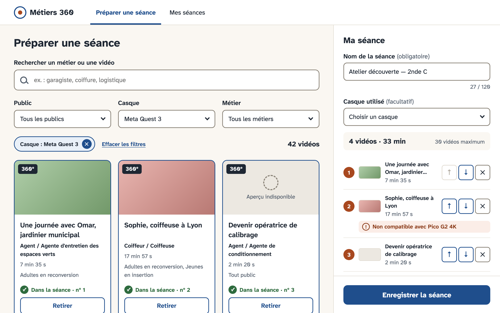

# Métiers 360 — Préparer une séance

Petite application pour trouver des vidéos 360°, composer une séance (choisir, ordonner, nommer) et
l'enregistrer via l'API simulée. React 18, TypeScript strict, Vite, React Router 7, TanStack Query,
Tailwind, React Aria Components.



## Lancer le projet

Avec Docker (API + application sur http://localhost:8080) :

```bash
docker compose up --build
```

Sans Docker (Node ≥ 20, application sur http://localhost:5173) :

```bash
npm start
cd app && npm install && npm run dev
```

Vérifications :

```bash
cd app && npm run typecheck && npm run lint && npm test
```

## Trois hypothèses qui ont le plus pesé

1. **On cherche un métier comme on le dit, pas par son code.** L'API ne cherche que dans les
   titres ; la saisie « garagiste » est rapprochée côté client des intitulés et appellations ROME
   et propose « Voir les vidéos : Mécanicien / Mécanicienne automobile ». Pas de bascule
   automatique : ce sont des suggestions.
2. **Le casque est facultatif, l'incompatibilité est signalée, jamais bloquante.** L'API ne
   vérifie rien ; une vidéo incompatible est marquée dans la séance, avec un raccourci pour
   n'afficher que les vidéos compatibles.
3. **Le brouillon ne se perd jamais, et une séance ne s'enregistre pas deux fois.** Brouillon
   dans `localStorage` ; 1 réessai automatique sur erreur serveur (l'API échoue avant de créer) ;
   après succès, le brouillon est figé jusqu'à « Préparer une nouvelle séance ».

Toutes les hypothèses : [`docs/DECISIONS.md`](docs/DECISIONS.md).

## Choix d'interface, et pour qui

Pour des conseiller·es et enseignant·es pressé·es, pas toujours à l'aise avec le numérique, qui
préparent parfois la séance sur une tablette devant le groupe.

- **Tout sur un écran.** Catalogue et panneau « Ma séance » côte à côte (ordinateur, tablette
  paysage) ; en tablette portrait, une barre fixe « Ma séance · 4 vidéos · 33 min » ouvre un tiroir.
  Le résumé reste toujours visible pendant la recherche.
- **Rien de fin ni de caché.** Cibles de 44 px, boutons ↑ ↓ ✕ plutôt que glisser-déposer, états
  écrits en toutes lettres (« ✓ Dans la séance · n° 2 »), police très lisible (Atkinson
  Hyperlegible).
- **Chaque attente et chaque erreur se rattrapent sans ressaisie.** Squelettes, message rassurant
  après 2 s, « Réessayer » qui garde recherche et filtres, erreurs sous le champ concerné.
  Accessibilité vérifiée par axe (tests + vrai navigateur), au clavier, à 320 px et au zoom 200 %.

Maquettes et notes : [`docs/maquettes/`](docs/maquettes/).

## Laissé de côté, volontairement

- **Glisser-déposer** : les boutons suffisent et marchent au clavier et au lecteur d'écran.
- **Filtres à plusieurs valeurs** : l'API n'accepte qu'une valeur par filtre.
- **Modifier une séance enregistrée** : l'API ne le permet pas ; « Repartir de cette séance »
  en fait une copie.
- **Doublon si la page est rechargée pendant l'envoi** : cas rare, l'API n'a pas de clé
  d'idempotence pour l'éviter.

## Avec une journée de plus

- Faire tourner en CI les parcours que j'ai vérifiés à la main dans un vrai navigateur
  (Playwright + axe sur l'API simulée).
- Tester avec deux ou trois utilisateur·ices réel·les sur tablette, avant d'ajouter quoi que ce
  soit.
- Filtre par durée totale (« une séance de 30 min »), demande probable de ce public.

## Usage de l'IA

- **Délégué** : maquettes (Claude Design), puis le code, les tests et la documentation à Claude
  Code, étape par étape, cadré par [`CLAUDE.md`](CLAUDE.md) et [`docs/PLAN.md`](docs/PLAN.md) : une
  branche et une PR par étape, fusion seulement après mon accord.
- **Vérifié moi-même** : design de l'application, relecture des PR et des captures tablette, parcours clavier et
  VoiceOver, tests sur tablette émulé
- **Une décision prise contre l'outil** : à l'étape 8, l'agent avait classé l'absence de lien
  « Aller à ma séance » en point non corrigé, puisque l'étape demandait de vérifier sans ajouter.
  Je l'ai fait ajouter : traverser 24 cartes au clavier pour atteindre « Enregistrer la séance »
  est trop long pour un public pressé.

## Temps d'attention

3 h, en 3 sessions (du 25 au 27 octobre 2026). Historique : une branche
fusionnée par étape (`git log --graph --oneline`).
